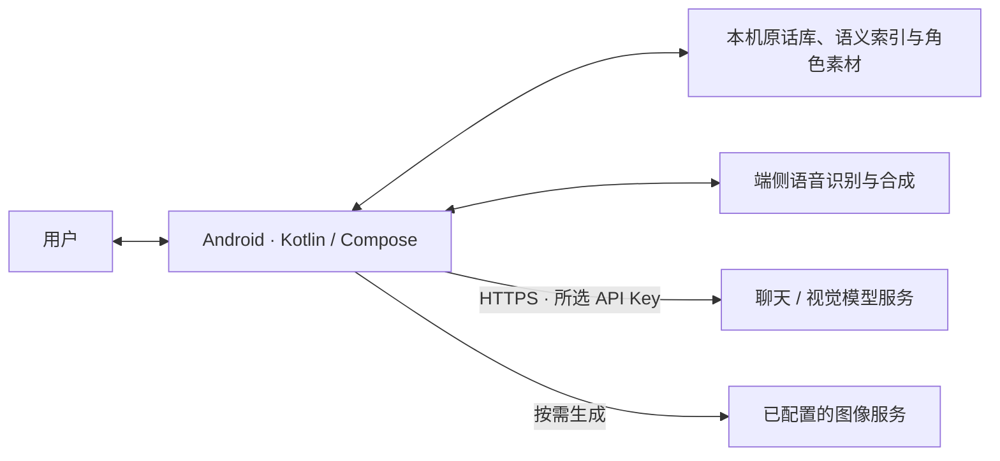

# 知语 · ZhiYu

**原生 Android AI 伴侣：持续聊天、原文记忆，以及属于同一个 OC 的声音与日常。**

知语面向长期相处的人机恋与原创角色（OC）陪伴场景。选择 AI 服务商、填写自己的 API Key 后，在同一段对话中继续相处；聊天、记忆索引和角色素材由手机管理，模型请求通过 HTTPS 发往所选服务。

手机独立版无需运行电脑后端、Docker 或 USB 映射。“本地优先”指数据存储和部分推理在设备上完成；**云端聊天、联网天气和远程生图仍需要网络及相应服务权限。**

[功能与边界](#功能与边界) · [快速使用](#快速使用) · [从源码构建](#从源码构建) · [端侧图像研究](#端侧图像研究) · [历史后端](#历史后端) · [验证记录](#验证记录) · [文档导航](#文档导航) · [宣传片源码与渲染](promo/README.md)

## 功能与边界

| 能力 | 当前实现 | 使用边界 |
| --- | --- | --- |
| 持续关系 | 单一聊天页面；API Key 验证；固定服务商、模型与恋人预设；自定义模式可继续调教 | 绑定作用于本次安装，不等于跨设备身份系统 |
| 原文记忆 | 本机 SQLite 原话库、BGE INT8 语义检索与词项补查；保留作者、时间和消息 ID | 检索结果作为独立原文提供，不以融合摘要替代正文；召回和模型理解仍可能出错 |
| 图文交流 | 连续发送、分段回复、图片识别、OC 参考与自拍／生活照库存 | 识图依赖模型能力；生成与审图需要可用的服务配置，人物一致性需检查 |
| 声音与通话 | 端侧 ASR／TTS、可选音色及语速／音高调整、支持打断的语音通话链路 | 实际延迟、回声和听感受设备与模型响应影响 |
| 通话看画面 | 0.2.18 增加摄像头开关和前后摄切换，每轮语音可携带当前一帧 | 需要视觉模型；属于单帧识图，尚不等于连续视频理解 |
| 动态形象 | 基于用户图片的局部网格动画；保留背景，支持手动标注与修正 | 不是任意图片自动生成完整 Cubism 模型；遮挡和活动范围需要确认 |
| 主动关心 | 按性格与互动安排主动联系、日常分享；授权后的天气与日历联动 | 后台执行受系统调度影响，厂商省电设置可能延迟通知 |
| 界面与资料 | 水彩风格、描边气泡、头像与背景、字号调整，以及本机 TXT／MD／PDF／DOCX 导入 | 资料解析与图片 OCR 各有格式和容量限制 |

各版本的实现、修复和未验证项见 [CHANGELOG](CHANGELOG.md)。摄像头、语音、动态形象的详细边界分别见[通话摄像头](docs/CALL_CAMERA_2026-10-19.md)、[语音通话](docs/DUPLEX_ANDROID_2026-10-15.md)和[手机动态形象教程](docs/LIVE2D_PHONE_GUIDE_ZH.md)。

### 数据如何流转



- **本机保存**：聊天原文、检索索引、导入资料与 OC 素材。API Key 使用 Android Keystore / AES-GCM 加密保存。
- **按请求发送**：当前输入、为本轮挑选的上下文，以及需要识图时的图片。使用云模型时，相应内容会交给所选服务处理。
- **摄像头单独授权**：仅在用户开启摄像头并授权后取帧；通话帧仅短时保留在内存中，不写入图片库或聊天附件。挂断、关闭摄像头或退后台会使旧帧失效。

记忆存档容量与模型上下文窗口是两回事：历史可以持续保存，每次请求仍需选择相关原文并控制输入预算。Android 与历史 Python 后端的 schema、迁移和排序算法也不等价，后端实验成绩不能直接视为手机端召回成绩。

## 快速使用

拿到适配设备的 APK 后：

1. 安装到 **Android 8.0 / API 26 及以上**设备；覆盖升级时保持原签名，保留应用数据。
2. 选择服务商和模型，填写自己的 API Key，完成验证与恋人设定。
3. 按需导入 OC 图片、调整头像／背景和声音，再开始聊天。通知、定位、日历与摄像头在使用相关能力时授权。

普通聊天与图像生成分别使用对应服务配置。只有聊天 Key，不代表图像服务已经配置完成。后台主动联系还需要手机允许知语后台运行；红米实测中的系统冻结问题与处理记录见 [USB 实机调试](docs/USB_REGRESSION_2026-10-19.md)。

[GitHub Releases](https://github.com/yanzhibuzhuoyv/zhiyu/releases) 当前主要提供端侧图像研究的模型权重；APK 是否可下载，以实际发布附件为准。没有 APK 时，可按下文准备资源并构建。

## 仓库结构

```text
zhiyu/
├── android/             手机端主产品：Kotlin、Jetpack Compose、本机存储与推理
├── rig2d/               参数化 2D 形象与语音协调的可移植 Kotlin/JVM 核心
├── native/qwen-edge/    端侧图像引擎：C++、JNI 与固定版本上游适配
├── qwen-image-edge/     Qwen-Image 剪层、蒸馏、量化实验与交付说明
├── shared/              共享行为契约与生成／一致性检查
├── backend/             历史 FastAPI 服务、兼容代码与研究工具
├── scripts/             资源准备、打包、评测与联调脚本
├── docs/                设计、操作指南、测试结果与已知边界
└── compose*.yaml        历史后端的 Docker 编排
```

架构导览见 [README-OVERVIEW](README-OVERVIEW.md)；具体能力与构建要求以当前源码、CHANGELOG 和对应专题文档为准。

## 从源码构建

以下命令以 **Windows PowerShell** 为例。先准备被构建脚本校验的模型与原生产物，再运行 Gradle；全新克隆并不包含所有必需资源。

### 1. 开发环境

| 项目 | 配置 |
| --- | --- |
| 构建 JDK | 已验证环境使用 JDK 23；所选 JDK 需满足 Gradle / AGP 的兼容要求 |
| Java 目标字节码 | 17，见 `sourceCompatibility` / `targetCompatibility` |
| Android SDK | `compileSdk = 36`、`targetSdk = 36`、`minSdk = 26` |
| Android NDK | `30.0.16248370`，重新编译 JNI 时使用 |
| Gradle / AGP | Wrapper `9.5.0` / Android Gradle Plugin `9.3.0` |
| Kotlin / Compose | Kotlin Compose 插件 `2.3.21`，Compose BOM `2026.06.01` |
| Python | 3.11+，用于资源准备和共享契约检查；`python` 需可从命令行调用 |
| CMake / Ninja | 重新编译 JNI 时需要；使用与脚本配置一致的工具链 |

```powershell
git clone https://github.com/yanzhibuzhuoyv/zhiyu.git
cd zhiyu
$env:PYTHONUTF8 = '1'
```

在 `android/local.properties` 中配置本机 SDK 路径，文件不提交：

```properties
sdk.dir=C:/Users/你的用户名/AppData/Local/Android/Sdk
```

### 2. 准备模型与原生产物

`artifacts/` 位于**仓库根目录**，默认被 Git 忽略。构建脚本从 `android/` 看它时，路径写作 `../artifacts/`。

| 资源位置 | 用途 | 准备入口 |
| --- | --- | --- |
| `artifacts/native-voice/` | sherpa-onnx AAR、中文流式 ASR 与 TTS 模型 | [prepare_native_voice.py](scripts/prepare_native_voice.py)；下载并校验固定公开文件 |
| `artifacts/portrait-models/u2netp.onnx` | 保留的人像处理模型 | [prepare_portrait_model.py](backend/prepare_portrait_model.py)，需指定 `--output` |
| `artifacts/semantic-models/` | BGE INT8、词表与配置／manifest | [prepare_semantic_model.py](backend/prepare_semantic_model.py)，需 `--source` 指定匹配的源模型目录；见[语义编码器说明](docs/LOCAL_SEMANTIC_ENCODER.md) |
| `artifacts/native-media-seed/` | 安装包内保留的两张示例图片与清单 | [prepare_native_media.py](scripts/prepare_native_media.py)；依赖既有源素材和授权清单，不会自动补齐所有素材 |
| `artifacts/model-packs/qwen-edge/manifest.json` | 离线图像模型包清单 | [模型打包工具](scripts/package_qwen_model.py)与[端侧接入说明](docs/QWEN_EDGE_NATIVE_PORT_2026-10-11.md) |
| `artifacts/android-qwen-jni/r2/jniLibs/` | Qwen 文本／图像 JNI 动态库 | [JNI 构建脚本](native/qwen-edge/android-jni/build.py)，需要 NDK、CMake 和已准备的上游源码 |
| `android/app/libs/rig2d-0.2.0-studio.jar` | 角色动画与语音协调核心 | **已入库**；源码在 [rig2d/](rig2d/)，构建时仍校验 SHA-256 |

这些入口有不同前置条件，不能把它们当作一条自动下载全部资源的安装命令。完整的大权重、部分源素材和准备好的上游源码需要另外取得。不要把 API Key、私人图片、聊天备份或权重提交到仓库。

构建前会检查模型、JNI、JAR 和共享契约的一致性。修改这些输入时，应同步更新匹配的校验与验证记录；跳过校验不能解决版本不匹配。

<details>
<summary>构建期校验入口</summary>

| Gradle task | 检查对象 |
| --- | --- |
| `verifyPlanarCore` | rig2d JAR 与 `assets/planar/contract.json` |
| `verifyQwenJni` | arm64-v8a / x86_64 的四个 Qwen JNI `.so` |
| `prepareQwenAssets` | 图像模型包 manifest |
| `preparePortraitAssets` | U2NetP 模型 SHA 与仅含两张图片的素材打包策略 |
| `prepareSemanticAssets` | BGE INT8、词表、配置与 manifest 的 SHA |
| `prepareVoiceAssets` | 语音模型文件及 sherpa-onnx AAR 的 SHA |
| `verifyCompanionContract` | 执行 `python shared/generate_companion_contract.py --check` |
| `prepareQwenTestAssets` 等测试资源任务 | 仪器测试所需的固定 checkpoint 与合成素材 |

</details>

### 3. 构建与测试

资源准备完成后：

```powershell
cd android
.\gradlew.bat :app:testDebugUnitTest :app:lintDebug
.\gradlew.bat :app:assembleDebug :app:assembleDebugAndroidTest
```

APK 输出到 `android/app/build/outputs/apk/`。已启用 ABI 分包，并生成 universal APK；手机安装时选择匹配的架构。

仪器测试应在**专用模拟器或测试机**运行，避免对日常使用、存有私人数据的安装直接执行整套测试：

```powershell
.\gradlew.bat :app:connectedDebugAndroidTest
```

Release 使用 `:app:assembleRelease`，已开启 R8；正式分发还需配置发布签名。当前手机独立版直接调用模型服务，不需要通过构建参数填入电脑后端地址。

<details>
<summary>主要 Android 依赖</summary>

| 依赖 | 当前版本／来源 | 用途 |
| --- | --- | --- |
| Activity Compose | 1.13.0 | 原生 Activity 与 Compose 入口 |
| Material 3 / Compose UI | Compose BOM 管理 | 聊天与设置界面 |
| Lifecycle Compose | 2.10.0 | ViewModel 与生命周期 |
| Kotlin Coroutines | 1.10.2 | 异步任务与取消 |
| OkHttp | 5.4.0 | HTTPS 模型请求 |
| CameraX | 1.6.2 | 通话预览与单帧采集 |
| WorkManager | 2.12.0 | 后台联系与索引任务 |
| ONNX Runtime Android | 1.30.0 | 本机语义与图像推理 |
| sherpa-onnx | 本地 1.13.8 AAR | 语音识别与合成 |
| ExifInterface / ML Kit 中文 OCR | 1.4.2 / 16.0.1 | 图片方向与文字提取 |
| PDFBox Android | 2.0.27.0 | PDF 资料解析 |
| rig2d | 本地 0.2.0 JAR | 形象网格与语音协调 |

准确依赖与锁定值见 [app/build.gradle.kts](android/app/build.gradle.kts)。

</details>

### 4. 单独开发 rig2d

rig2d 是纯 Kotlin/JVM 核心，测试不依赖 Android SDK、NDK 或手机：

```powershell
cd rig2d
.\gradlew.bat test jacocoTestReport jar
.\gradlew.bat duplexFixture
.\gradlew.bat partsFixture
python -m unittest discover -s probe/tests -v
python -m unittest discover -s tools/tests -v
```

`duplexFixture` 使用合成语音链路，不录制麦克风。JAR 排除了使用宿主 ImageIO 的演示驱动，也不包含 Python 工坊或语音模型。修改核心后，需按 [PORTING](rig2d/docs/PORTING.md) 同步 Android 使用的 JAR、契约与校验值。

## 端侧图像研究

[qwen-image-edge/](qwen-image-edge/) 记录 Qwen-Image 的剪层、蒸馏学生和 GGUF 量化实验；Android 接入代码位于 [native/qwen-edge/](native/qwen-edge/)。它与远程图像服务是不同实现路径，某个实验能出图不代表所有手机都已具备相同速度、内存表现或编辑能力。

| 路线 | 取舍 | 适用范围 |
| --- | --- | --- |
| L36 | 保留完整层数，作为质量与编辑对照 | 基线验证 |
| L24 | 减少编码器层数，发布配置保留视觉塔 | 需要参考图与编辑能力的研究路径 |
| 蒸馏学生 0.6B / 1.7B + 适配器 | 更小的文本编码器，需与匹配的适配器使用 | 当前主要验证文生图，不能直接沿用教师的编辑能力结论 |

**为什么选 L24，而不是更深的 L28？** 在已有的全身扩图对照中，L24 为 6/6，L28 为 0/6；另一次 1024² 画风检查中，L24 为 11/12，L20 为 4/12。因此当前选型依据是实际出图和编辑测试，不只看表示余弦。这些结果属于对应任务与样本，不是所有提示词的画质保证。

- [文本编码器剪层实验](qwen-image-edge/实验一报告-文本编码器剪层.md)
- [L36 / L28 / L24 六种子确认实验](qwen-image-edge/剪层确认实验报告-L36-L28-L24-6seed.md)
- [蒸馏实验](qwen-image-edge/实验二报告-蒸馏.md)
- [模型交付清单、体积账本与复现入口](qwen-image-edge/交付说明.md)
- 下载：[L24 编码器](https://github.com/yanzhibuzhuoyv/zhiyu/releases/tag/te-encoder-L24) · [蒸馏学生](https://github.com/yanzhibuzhuoyv/zhiyu/releases/tag/distill-students)

编码器、适配器及 DiT / VAE 的文件体积应分开比较；模型包磁盘大小也不等于手机推理时的峰值内存。

重新编译 JNI 时，脚本需要显式路径，例如在仓库根目录运行：

```powershell
python native/qwen-edge/android-jni/build.py `
  --ndk "<NDK目录>" `
  --cmake "<cmake.exe路径>" `
  --llama "<已准备的llama源码目录>" `
  --sd "<已准备的diffusion源码目录>" `
  --output artifacts/android-qwen-jni/r2
```

上游版本与补丁由 [upstream-lock.json](native/qwen-edge/diffusion/upstream-lock.json) 固定。构建会审计 JNI 导出、动态依赖与 16 KiB 对齐；输出与已有产物不同时，需先核对来源及校验，不能直接覆盖已冻结的模型或库。

## 历史后端

`backend/` 保留 FastAPI 服务、早期部署与研究工具。手机独立版不依赖此服务；旧后端检索采用 FTS5 / BM25，手机端采用本机 BGE 语义检索与 FTS4 补查。后端的测试与数据库不能替代 Android 验证。

历史启动入口：

```powershell
# 在仓库根目录执行，默认仅监听 127.0.0.1:8790
.\scripts\Start-Backend.ps1
.\scripts\Start-Backend.ps1 -Demo
```

启动后可访问 [API 文档](http://127.0.0.1:8790/docs)与[健康检查](http://127.0.0.1:8790/health)。基础环境为 Python 3.11+、SQLite ≥ 3.43（需 FTS5）；依赖由 `backend/uv.lock` 锁定，`semantic`、`portrait` 为可选功能依赖。

```powershell
cd backend
uv sync --frozen --extra dev
uv run --no-sync ruff check app tests
# 完整测试还需准备所选测试涉及的可选依赖与资源
uv run --no-sync pytest --cov=app --cov-report=term-missing
```

Docker 仍可用于历史服务和隔离测试：

```powershell
# 在仓库根目录执行
docker compose up --build -d --wait
.\scripts\Test-Docker.ps1
```

镜像、数据卷与测试用法见 [Docker 文档](docs/DOCKER.md)，旧 USB／电脑后端接入见[历史 Android 后端说明](docs/ANDROID_BACKEND_LEGACY.md)。

## 验证记录

以下是对应版本已记录的验收结果，**不是当前工作区的实时 CI 状态**。新增功能、未提交改动和不同设备需要另行验证。

| 对象 | 记录结果 | 证据与边界 |
| --- | --- | --- |
| Android 0.2.18 | 965 JVM / 145 suites；495 Native / 98 类；lint 0 Error | [通话摄像头报告](docs/CALL_CAMERA_2026-10-19.md)；模拟器与合成／假摄像头验证，真实手机画质和热节流待验证 |
| Android 0.2.17 | 948 JVM；481 Native；lint 0 Error | [反馈 47–49](docs/FEEDBACK_47_49_2026-10-19.md) |
| 红米 Turbo 3 · 0.2.17 | 同秒报时、真实自拍附件、保存后的局部动画，以及一次后台主动通知 | [USB 实机记录](docs/USB_REGRESSION_2026-10-19.md)；不等于整夜到达率或所有 OC 均通过 |

旧 README 还记录过 2026-10-16 的后端克隆验证：892 项通过、当时覆盖率 95%、Ruff 通过。该数字仅保留为历史记录；依赖、测试范围和源码变化后，应以重新运行的结果为准。

模型效果、长对话记忆、声音听感和真实手机稳定性是不同维度。测试数量不能替代实际场景质量；对应研究过程与失败记录保留在 `docs/` 中。

## 常见问题

| 问题 | 检查方向 |
| --- | --- |
| 新克隆无法构建 | 先核对根目录 `artifacts/` 的模型、种子素材和 JNI；仓库源码不包含全部准备资源 |
| `SDK location not found` | 检查 `android/local.properties` 和已安装 SDK |
| `* SHA mismatch` / 契约校验失败 | 对照 Gradle 中的固定文件与来源；同步匹配版本，不跳过校验 |
| 模型包已经下载，但不能生成 | 核对完整清单、适配器、运行时与设备能力；单独的编码器并非完整生图模型 |
| 摄像头已开，恋人仍看不到 | 检查摄像头权限、视觉模型支持、当前帧是否可用；见[摄像头说明](docs/CALL_CAMERA_2026-10-19.md) |
| 后台没有主动消息 | 检查通知、自启动与应用省电策略，以及人格间隔；见[实机调试](docs/USB_REGRESSION_2026-10-19.md) |
| 动态形象画面正常但不动 | 检查图层类型、头部活动范围、擦除与幅度；按[教程](docs/LIVE2D_PHONE_GUIDE_ZH.md)预览并保存 |
| GitHub 推送或 Release 上传失败 | 分别检查 DNS、TLS、代理与 `github.com` / `api.github.com` / `uploads.github.com` 的连通性；单个域名可访问不足以确认故障原因 |

若使用系统代理，先确认当前实际地址，再为单次 Git 命令配置；不要假定本机代理端口固定，也不要为了排障关闭 TLS 校验。

## 文档导航

| 想了解什么 | 入口 |
| --- | --- |
| 版本功能与修复 | [CHANGELOG](CHANGELOG.md) |
| 仓库总览 | [README-OVERVIEW](README-OVERVIEW.md) |
| 语义编码器与本机记忆生命周期 | [本机编码器](docs/LOCAL_SEMANTIC_ENCODER.md) · [记忆生命周期](docs/NATIVE_MEMORY_LIFECYCLE.md) |
| 原文、压缩与历史容量研究 | [正文存储](docs/BODY_STORAGE.md) · [冷归档实测](docs/MEMORY_COLD_PROOF.md) |
| 召回顺序与论文参考实验 | [检索顺序 A/B](docs/MEMORY_RETRIEVAL_ORDER_EVAL.md) · [VoiceMem 研究与 A/B](docs/VOICEMEM_RESEARCH_AND_AB_2026-10-15.md) |
| OC、声音、权限与通话 | [动态形象教程](docs/LIVE2D_PHONE_GUIDE_ZH.md) · [本地语音](docs/LOCAL_VOICE_NATIVE.md) · [天气与日历](docs/CARE_FEATURES.md) · [摄像头](docs/CALL_CAMERA_2026-10-19.md) |
| 端侧图像引擎 | [交付说明](qwen-image-edge/交付说明.md) · [Android 原生接入](docs/QWEN_EDGE_NATIVE_PORT_2026-10-11.md) |

## 来源与许可

本项目为个人学习与自用项目，非任何 AI 服务商或机构的官方产品。调用第三方服务需要使用者自己的 API Key，服务费用与授权范围由对应服务决定。

Qwen-Image-2.1-Turbo 的衍生权重遵循随附的 [Qwen Research License](qwen-image-edge/LICENSE-Qwen-Image-2.1-Turbo)，其他模型、代码和素材分别保留其来源及许可说明。使用和分发前应阅读对应许可；仓库包含某项资源或研究代码，不代表已取得其所有使用场景的授权。

**Built with Qwen. Improved using Qwen.**
